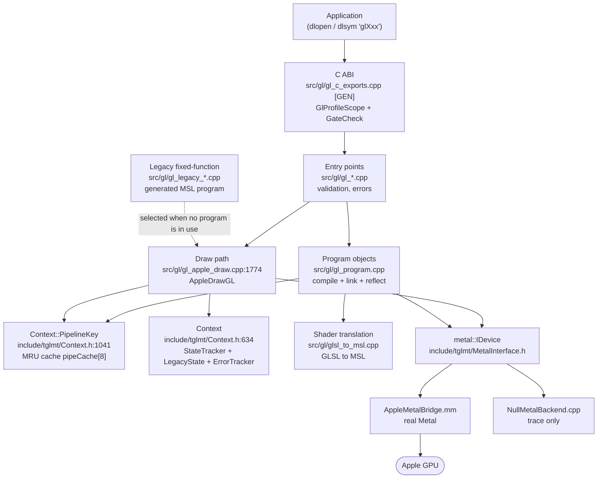

# OPENGL → METAL ARCHITECTURE — TGLMT

> A guided tour of TGLMT for a reader who has not seen the code before:
> what happens to **one** OpenGL call, from the application down to the GPU,
> and where each piece of the machinery lives.
>
> Scope: the whole library, both the modern programmable pipeline (GL 2.0–4.6)
> and the legacy fixed-function pipeline (GL 1.0–2.1, Compatibility Profile).
> For the legacy-specific design see `docs/UNIFIED_GRAPHICS_ARCHITECTURE.md`.

---

## 1. What TGLMT is

TGLMT is a **from-scratch implementation of desktop OpenGL 1.0–4.6 that
translates directly to Metal**. There is no Mesa, no Zink, no MoltenVK, no
ANGLE, and no third-party state tracker or GLSL→NIR in the path
(`docs/DECISIONS.md` A1, A2).

| | |
|---|---|
| Language | C++17 for the core; Objective-C++ (`.mm`, ARC) for the Metal layer |
| Public API | A **C ABI** (`extern "C"`) so that apps can `dlopen`/`dlsym` plain `glXxx` symbols |
| Target | iOS 16+, hardware target **Apple A11** (iPhone 8/X) |
| Output | `libtglmt.dylib` + an `.xcframework` |
| Backends | `apple` (real Metal) and `null` (a trace-only backend for CI) |

The two backends are selected at build time / runtime:

```bash
cmake -S . -B build-work -DCMAKE_BUILD_TYPE=Debug          # Null backend
cmake -S . -B build-ios -DCMAKE_BUILD_TYPE=Release \
      -DTGLMT_APPLE_METAL=ON -DCMAKE_OSX_SYSROOT=iphoneos  # real Metal
cmake --build build-work -j8 && (cd build-work && ctest -j8)
```

`TGLMT_APPLE_METAL=OFF` (the default) builds the Null backend, which is
enough to test the whole state machine without a GPU.

---

## 2. The path of one call

Take `glDrawElements(GL_TRIANGLES, 36, GL_UNSIGNED_SHORT, 0)` issued by an
application that has a linked program bound.

### 2.1 The whole chain

```
   APPLICATION (LWJGL / C++ app / Minecraft Java)
        │  dlsym("glDrawElements")  →  plain C symbol
        ▼
┌──────────────────────────────────────────────────────────────────────┐
│ L1  C ABI FRONTEND          src/gl/gl_c_exports.cpp   (GENERATED)   │
│     • GlProfileScope  — times every call (gltop# diagnostics)        │
│     • tglmt::GateCheck(n) — version/profile gate                      │
│         not in (version, profile)? → GL_INVALID_OPERATION, NOT run  │
│     → forwards 1:1 into tglmt::gl::                                  │
└──────────────────────────────────────────────────────────────────────┘
        │  gl::glDrawElements(mode, count, type, idx)
        ▼
┌──────────────────────────────────────────────────────────────────────┐
│ L2  ENTRY POINT + VALIDATION       src/gl/gl_draw.cpp:131 EmitDraw    │
│     • mode / type / count validated  → INVALID_ENUM / INVALID_VALUE  │
│     • primitive-restart splitting, UBYTE index expansion             │
│     • conditional render, XFB-mode compatibility checks              │
│     • pipe-stats counters                                            │
└──────────────────────────────────────────────────────────────────────┘
        │  AppleDrawGL(mode, count, type, idx, …)
        ▼
┌──────────────────────────────────────────────────────────────────────┐
│ L4  DRAW PATH                      src/gl/gl_apple_draw.cpp:1774      │
│     1. program  ─────────► ProgramObject (VS/FS libraries)          │
│     2. VAO     ─────────► metal::CustomAttrib[16]  (vertex layout)  │
│     3. target  ─────────► IRenderTarget (FBO wrap / default FB)     │
│     4. pipeline─────────► Context::PipelineKey → MRU cache → PSO    │
│     5. encoder ─────────► IRenderEncoder (reused across draws)      │
│     6. resources────────► buffers, textures, samplers, uniforms      │
│     7. draw    ─────────► drawIndexed / drawPrimitives              │
└──────────────────────────────────────────────────────────────────────┘
        │                      ▲
        │                      └── L3  LEGACY FIXED-FUNCTION PATH
        │                          (GL 1.0–2.1; selected when no program
        │                           is in use — see UNIFIED_GRAPHICS_
        │                           ARCHITECTURE.md §4.6)
        ▼
┌──────────────────────────────────────────────────────────────────────┐
│ L6  SHADER TRANSLATION (at link time, not at draw time)              │
│     src/gl/glsl_to_msl.cpp — GLSL → MSL (token/string rewriter)      │
│     src/gl/gl_program.cpp  — compile + link + reflection             │
│     IDevice::compileLibrary → id<MTLLibrary>                        │
└──────────────────────────────────────────────────────────────────────┘
        ▼
┌──────────────────────────────────────────────────────────────────────┐
│ L7  METAL BACKEND                  src/metal/AppleMetalBridge.mm     │
│     makeCustomPipeline → MTLRenderPipelineState                     │
│     setVertexBuffer / setFragmentBuffer / setFragmentTexture / …     │
│     drawIndexed → the GPU                                             │
└──────────────────────────────────────────────────────────────────────┘
        ▼
                      APPLE GPU (A11)
```

### 2.2 The same call, step by step, with `file:line`

**Step 1 — the C ABI.** `src/gl/gl_c_exports.cpp` is **generated** by
`tools/gen_c_exports.py` and contains one flat `extern "C"` wrapper per
entry point. Each wrapper does exactly three things:

```cpp
// src/gl/gl_c_exports.cpp:1850
void glDrawElements(GLenum mode, GLsizei count, GLenum type, const void *indices) {
    GlProfileScope _gp(137);              // include/tglmt/GlProfile.h:27 — timing probe
    if (!tglmt::GateCheck(190)) return;   // include/tglmt/VersionGate.h:70
    gl::glDrawElements(mode, count, type, indices);
}
```

`GateCheck` is the **version/profile gate**: an entry point that does not exist
in the context's `(version, profile)` produces `GL_INVALID_OPERATION` and the
call is **not executed** (GL 4.6 Core spec §2.3). The gate lives at the C
ABI, not in the internal C++ layer, by decision `docs/DECISIONS.md` D-003 — so
that apps calling plain `glXxx` symbols are covered.

**Step 2 — validation and draw preparation.** `EmitDraw`
(`src/gl/gl_draw.cpp:131`) validates the mode and the index type *before*
anything else (`src/gl/gl_draw.cpp:142-143`), because the comment at
`:135-141` records a real bug: an invalid mode used to be reported but the
draw still went through.

**Step 3 — the draw path.** `AppleDrawGL` (`src/gl/gl_apple_draw.cpp:1774`)
is the single place where a GL draw becomes Metal work. Its seven steps are
numbered in the source:

| Step | Source | What it does |
|---|---|---|
| 1 | `src/gl/gl_apple_draw.cpp:1786-1805` | find the bound `ProgramObject` (or the bound program pipeline) |
| 2 | `src/gl/gl_apple_draw.cpp:2018-2082` | VAO → `metal::CustomAttrib[16]` + the buffer bindings |
| 3 | `src/gl/gl_apple_draw.cpp:2153-2244` | FBO → `IRenderTarget` (`Context::WrapTarget`, `src/core/Context.cpp:560`) |
| 4 | `src/gl/gl_apple_draw.cpp:2276-2403` | build `Context::PipelineKey`, look it up in the MRU cache, otherwise build the PSO |
| 5 | `src/gl/gl_apple_draw.cpp:2409-2493` | reuse the open render encoder, or open a new one |
| 6 | `src/gl/gl_apple_draw.cpp:2494-3735` | bind buffers, textures, samplers, uniforms |
| 7 | `src/gl/gl_apple_draw.cpp:3736-3742` | `drawIndexed` / `drawPrimitives` |

**Step 4 — the pipeline key.** `Context::PipelineKey`
(`include/tglmt/Context.h:1041-1108`) is the CPU-side description of
everything the Metal pipeline state object depends on: the two shader library
identities, the link generation, the pixel format, the stride, the depth /
stencil / sample configuration, the MRT formats and blends, and the vertex
descriptor. `operator==` (`:1064-1107`) compares every field.

The cache is an 8-entry MRU (`Context::pipeCache[8]`,
`include/tglmt/Context.h:1117-1123`), consulted at
`src/gl/gl_apple_draw.cpp:2374-2378`. A hit **skips the bridge lookup
entirely** (string building + mutex in the backend) — that is the
`appleStats.pipelineLookupSkipped` counter.

**Step 5 — encoder reuse.** TGLMT does **not** create one command buffer per
draw. `Context::pendingEncoder` (`include/tglmt/Context.h:909`) holds an open
render encoder across consecutive draws that target the same attachments; it
is flushed when the target changes, when a readback happens, or at the end of
the frame (`Context::FlushPendingEncoder`, `src/core/Context.cpp:212`).

**Step 6 — the Metal backend.** `src/metal/AppleMetalBridge.mm` is the
Objective-C++ implementation of the `IDevice` interface. `makeCustomPipeline`
(`:2661`) builds the `MTLVertexDescriptor` from the `CustomAttrib` array and
then builds a **string key** (`:2705-2790`) that includes the two library
identities, the entry-point names, the format, the stride, every attribute,
the depth/stencil description and the per-attachment blends. That string is
the backend's own pipeline cache.

---

## 3. Block diagram

### 3.1 ASCII

```
                        ┌────────────────────────────────┐
  APPLICATION ─────────▶│  C ABI  (gl_c_api.h)           │  L1
  (dlsym / link)        │  gl_c_exports.cpp  [GENERATED] │
                        │   GlProfileScope + GateCheck   │
                        └───────────────┬────────────────┘
                                        │
                        ┌───────────────▼────────────────┐
                        │  tglmt::gl::  entry points      │  L2/L4
                        │  gl_draw.cpp gl_program.cpp     │
                        │  gl_texture.cpp gl_buffer.cpp   │
                        │  gl_framebuffer.cpp gl_compute  │
                        │  gl_legacy_*.cpp  ◀── L3       │
                        └───────────────┬────────────────┘
                                        │
                        ┌───────────────▼────────────────┐
                        │  Context   (include/tglmt/      │  L2
                        │             Context.h:634)      │
                        │  • StateTracker   (GL state)    │
                        │  • LegacyState    (GL 1.x)      │
                        │  • ErrorTracker   (FIFO errors) │
                        │  • ObjectRegistry (12 kinds)    │
                        │  • PipelineKey + MRU cache      │
                        │  • pending* encoder / state     │
                        │  • ring allocator, staging      │
                        └───────────────┬────────────────┘
                                        │
                        ┌───────────────▼────────────────┐
                        │  metal::IDevice (interface)     │  L7
                        │  include/tglmt/MetalInterface.h │
                        └──────┬──────────────────┬───────┘
                               │                  │
                ┌──────────────▼───┐      ┌───────▼─────────────────┐
                │ AppleMetalBridge │      │ NullMetalBackend        │
                │      .mm         │      │ (trace only, 79 lines)  │
                │  id<MTL*> objects│      │ src/metal/              │
                └──────────────┬───┘      │   NullMetalBackend.cpp  │
                               │          └────────────────────────┘
                               ▼
                        ┌─────────────┐
                        │  Metal GPU  │
                        └─────────────┘
```

### 3.2 Mermaid



### 3.3 The layers of the source tree

| Directory | Role | Files |
|---|---|---|
| `include/tglmt/` | Public headers — the C ABI, the context, the state machine, the Metal interface | 18 files |
| `src/core/` | Context, state machine, error tracker, object registry, the renderer façade | 5 files |
| `src/gl/` | The OpenGL entry points, the draw path, the shader translator | 46 files (3 generated) |
| `src/metal/` | The Metal backend and the Null backend | 2 files |
| `tools/` | The generators — every generated artefact in the tree comes from here | see `AGENTS.md` §5 |
| `tests/` | CTest suites: `unit/`, `integration/`, `regression/`, `api/`, `conformance/`, `shaders/` | ~180 tests |

---

## 4. Component reference

### 4.1 The API surface

| Component | Location | Notes |
|---|---|---|
| Public C ABI | `include/tglmt/gl_c_api.h` | **generated** by `tools/gen_c_exports.py`; 1049 `extern "C"` prototypes |
| Legacy prototypes | `include/tglmt/gl_legacy.h` | **generated** by `tools/gen_gl_headers.py`; 349 GL 1.x–2.1 prototypes |
| Core prototypes | `include/tglmt/gl46.h` | **generated**; 657 core + 42 compatibility-only |
| Enums | `include/tglmt/gl46_types.h`, `include/tglmt/gl_legacy_types.h` | **generated** from `docs/khronos/gl.xml` |
| Context creation | `src/gl/gl_context_api.cpp:17` `tglmtCreateContextAttribs` | version + profile + flags; `NULL` on a contradictory request |
| Make current | `src/gl/gl_context_api.cpp:55` `tglmtMakeCurrent` | |
| Proc address | `src/gl/gl_context_api.cpp:78` `tglmtGetProcAddress` | returns `NULL` for an entry point invalid in this context |
| Version gate | `include/tglmt/VersionGate.h`, `src/gl/gl_version_gate_gen.cpp` | 1048 entries, 38-bit mask (19 versions × 2 profiles) |

### 4.2 State and context

| Component | Location | Notes |
|---|---|---|
| Context | `include/tglmt/Context.h:634` | one context per thread; holds *everything* |
| Current context | `src/core/Context.cpp:10` `thread_local Context* Context::tCurrent_` | `:115-120` `Current()` with a global fallback |
| Version / profile | `include/tglmt/Context.h:650-661` | `glMajor/glMinor/glProfile/glContextFlags/glVersionSlot/glGateMask` |
| GL state machine | `include/tglmt/StateTracker.h`, `src/core/StateTracker.cpp` | caps, blend×8, depth/stencil, viewport×16, scissor×16, raster, pixel-store, bindings, plus a generic `SetShadow`/`GetShadow` store for `glGet*` |
| Legacy state | `include/tglmt/LegacyState.h:126` | matrix stacks, current vertex attributes, immediate mode |
| Error queue | `include/tglmt/ErrorTracker.h`, `src/core/ErrorTracker.cpp` | **FIFO** — one `glGetError` pops one error |
| Object ids | `include/tglmt/ObjectRegistry.h` | monotonic id generator shared by 12 object kinds |
| Object stores | `include/tglmt/Context.h:666-687` | buffers, VAOs, textures, samplers, shaders, programs, pipelines, FBOs, renderbuffers, queries, syncs, XFBs |

### 4.3 The draw path

| Component | Location | Notes |
|---|---|---|
| Draw entry points | `src/gl/gl_draw.cpp` | `glDrawArrays`, `glDrawElements`, the instanced / base-vertex / base-instance family, `MultiDraw*`, indirect draws |
| The core draw | `src/gl/gl_apple_draw.cpp:1774` `AppleDrawGL` | the only place a GL draw becomes Metal work |
| Pipeline key | `include/tglmt/Context.h:1041-1108` | + MRU cache `:1117-1123` |
| Encoder reuse | `include/tglmt/Context.h:909-911`; `src/core/Context.cpp:212` | one encoder for many draws |
| Uniform staging cache | `include/tglmt/Context.h:1029-1036` | skips the upload when the bytes are unchanged |
| Ring allocator | `include/tglmt/Context.h:1224-1235`; `src/core/Context.cpp:600` | 4 MB × 5 frames; temporary uploads come from here |
| Buffer staging | `include/tglmt/Context.h:1124-1135` | `glBufferSubData` coalesces into ranges, flushed on demand |
| Texture staging | `include/tglmt/Context.h:1142-1151` | same idea for `glTexSubImage*` |

### 4.4 Shaders

| Component | Location | Notes |
|---|---|---|
| GLSL → MSL translator | `src/gl/glsl_to_msl.cpp` (12 627 lines) | a token/string rewriter with ~60 passes — **not** a compiler front end |
| The translation contract | `include/tglmt/GLSLConverter.h` | `GLSLVar`, `GLSLBlock`, `GLSLConvertResult`, `ConvertGLSLtoMSL()` |
| Program objects | `src/gl/gl_program.cpp` | compile → link → reflection; `pr.linked = true; ++pr.linkGen;` at `:852` |
| Library compile | `src/metal/AppleMetalBridge.mm:1783` `compileLibrary` | `newLibraryWithSource` + error log |
| Library identity | `src/metal/AppleMetalBridge.mm:438-445` | a **monotonic serial**, never a pointer — see `include/tglmt/MetalInterface.h:313-324` for why |
| Clip-space z conversion | `src/gl/glsl_to_msl.cpp:10356` | GL `z ∈ [−w, w]` → Metal `z ∈ [0, w]`, baked into every generated vertex shader |
| Viewport conversion | `include/tglmt/GLConvert.h:21-45` | GL lower-left origin → a **negative-height** Metal viewport (the framebuffer memory stays in GL order) |

### 4.5 The Metal backend

| Component | Location | Notes |
|---|---|---|
| The interface | `include/tglmt/MetalInterface.h` | `IDevice` plus `IBuffer`, `ITexture`, `ILibrary`, `IRenderPipeline`, `IRenderTarget`, `IRenderEncoder`, `IComputeEncoder` |
| The real backend | `src/metal/AppleMetalBridge.mm` (3 494 lines) | Objective-C++ with ARC |
| The Null backend | `src/metal/NullMetalBackend.cpp` (79 lines) | records a `DrawTrace` so unit tests can assert on draw behaviour without a GPU |
| Pipeline creation | `src/metal/AppleMetalBridge.mm:2661` `makeCustomPipeline` | builds the `MTLVertexDescriptor` and the backend's own string cache key |
| Present | `src/metal/AppleMetalBridge.mm` `presentTarget` | blits into a `CAMetalLayer` drawable |

### 4.6 The application-facing façade

| Component | Location | Notes |
|---|---|---|
| Renderer | `include/tglmt/Renderer.h`, `src/core/Renderer.cpp` | `Init` / `Resize` / `BeginFrame` / `EndFrame` / `ReadPixels` over one `Context` |
| Frame lifecycle | `src/core/Renderer.cpp:51-92` | `BeginFrame` rotates the ring allocator and creates the default target; `EndFrame` flushes the encoder + staging and presents |
| GLFW-shaped shim | `include/tglmt/GLFWShim.h`, `src/gl/glfw_shim.cpp` | `CreateWindow` / `MakeContextCurrent` / `SwapBuffers` / `GetProcAddress` |
| iOS shell | `apps/aquarium/ios_shell.mm` | `UIWindow` + `UIView(CAMetalLayer)` + `CADisplayLink` |

---

## 5. The context and thread model

### 5.1 One context per thread

**CURRENT.** `Context::tCurrent_` is a `thread_local`
(`src/core/Context.cpp:10`); `Context::MakeCurrent` sets it
(`src/core/Context.cpp:120`); `Context::Current()` returns it, falling back to
a shared global Null context if nothing is current
(`src/core/Context.cpp:115-118`).

`Context::CurrentPtr()` (`include/tglmt/Context.h:640`) is the fast path used
by the version gate — it returns the pointer without creating a fallback.

### 5.2 Rules

* **A GL context is not thread-safe.** One thread may use one context at a
  time; different threads may use different contexts concurrently.
* **A context must be made current on the thread that uses it.**
* **Objects are not shared between contexts.** There is no
  `glShareLists`-equivalent in the current implementation; `Context::programs`,
  `Context::buffers` and the rest are per context. *(Known gap — see
  `other/prompt.md` §7 "Layer 7.1": context sharing and multi-threaded
  resource lifetime are not yet implemented.)*
* The device (`Context::device`, `include/tglmt/Context.h:663`) is per
  context, but the underlying `MTLDevice` is shared process-wide.

### 5.3 Context creation

```c
TGLMTContextAttribs a = {0};
a.major = 2;  a.minor = 1;  a.profile = TGLMT_PROFILE_LEGACY;
TGLMTContext* ctx = tglmtCreateContextAttribs(&a);
tglmtMakeCurrent(ctx);
```

The rules (decision `docs/DECISIONS.md` D-002):

* version ∈ 1.0 … 4.6;
* `Core` / `Compatibility` are only valid from **3.2**; `Legacy` only below
  3.2 — a contradictory request is **rejected** (`NULL`), never silently
  coerced;
* `Compatibility` + `FORWARD_COMPATIBLE` is contradictory ⇒ rejected;
* `NO_ERROR` is only valid together with `DEBUG`.

---

## 6. Resource lifetime

### 6.1 Who owns what

| Resource | Owner | Lifetime |
|---|---|---|
| `Context` | the application (`Renderer` holds one) | until `Renderer` is destroyed; `~Context` flushes any open encoder first (`include/tglmt/Context.h:1327-1330`) |
| GL objects (buffers, textures, VAOs, programs, …) | the context (`Context::buffers`, `Context::textures`, …) | until `glDelete*`; deleting unbinds them from the bound state |
| `MTLBuffer` / `MTLTexture` | a `std::shared_ptr` inside the GL object (`BufferObject::gpu`, `TextureObject::gpu`) | until the GL object is deleted **or** the buffer is rotated out of the in-flight pool |
| In-flight GPU resources | `Context::pendingKeep` (`include/tglmt/Context.h:1155`) | until the encoder is flushed — the Metal encoder holds raw pointers, so the `shared_ptr` must outlive the commit |
| Temporary uploads (uniforms, UBO, index rewrite) | the ring allocator (`Context::ringBuf[5]`) | rotated per frame; a slot is not reused until the GPU has executed the frame that used it (`Context::ringUsedGen`, `include/tglmt/Context.h:1233`) |
| Buffer pool slots | `BufferObject::pool` (`include/tglmt/Context.h:57`) | used when the GPU is still reading a buffer that the app is overwriting |
| Shader libraries | `ProgramObject::appleVS` / `appleFS` (`include/tglmt/Context.h:379`) | until the program is relinked or deleted — `linkGen` is bumped so the pipeline cache cannot return a stale PSO |

### 6.2 The in-flight write hazard

The A11 is a tile-based deferred renderer: a buffer that the GPU is still
reading must not be overwritten by the CPU. TGLMT handles this in two ways:

* **Buffer rotation.** When the GPU is busy with a buffer the app wants to
  write, TGLMT allocates (or takes from the pool) a different `MTLBuffer` and
  copies — `BufferObject::pool` (`include/tglmt/Context.h:48-57`) and
  `appleStats.bufRotated`.
* **Deferred staging.** `glBufferSubData` writes into a CPU shadow and records
  a range; the actual GPU copy happens at flush time
  (`Context::StageBufferRange` / `FlushBufferStaging`,
  `include/tglmt/Context.h:1133-1135`), and the flush is forced before any
  draw that reads the buffer.

### 6.3 Memory trimming

`Context::TrimCachedMemory` (`include/tglmt/Context.h:1294`) releases the CPU
shadows that can be re-read from the GPU, and
`Context::MaybeTrimForAllocation` (`:1298`) calls it before a large
allocation. This exists because the iOS jetsam limit is ~2.1 GB on an
iPhone 8 Plus and the shadow copies were a measurable contributor.

---

## 7. How to add a feature

The recipes below are the ones that come up repeatedly.

### 7.1 Add an OpenGL entry point

1. **Never hand-edit a generated file.** If the entry point is new in the
   Khronos registry, it is picked up automatically by the generators.
2. Run the generators **in this order** (`AGENTS.md` §5):

   ```bash
   python3 tools/gen_gl_headers.py        # gl46_types.h, gl46.h, gl_legacy_types.h, gl_legacy.h
   python3 tools/gen_version_inventory.py  # data/version_inventory.json + the version matrices
   python3 tools/gen_version_gate.py      # src/gl/gl_version_gate_gen.cpp
   python3 tools/gen_c_exports.py         # include/tglmt/gl_c_api.h + src/gl/gl_c_exports.cpp
   python3 tools/gen_stubs.py             # src/gl/gl_stubs_gen.cpp
   ```

3. Implement the behaviour in the appropriate `src/gl/gl_*.cpp`.
   `tools/gen_stubs.py` only understands *definitions*, never *calls*: if a
   new file calls `glXxx()`, the generator will think it is implemented and
   will not emit a stub ⇒ a link error (`AGENTS.md` §9.2).
4. Add a test under `tests/unit/` (or `integration/`, `regression/`, …).
   Tests are auto-registered by a CMake `file(GLOB … CONFIGURE_DEPENDS)`
   (`CMakeLists.txt:107-108`). Use `TGLMT_CHECK` from `tests/test_util.h` —
   **not** `assert()`, because `NDEBUG` erases the expression in a Release
   build and the test turns green without testing anything.

### 7.2 Add a GLSL feature

The translator is a **rewriter**, not a compiler. A new GLSL construct
usually means: recognise it, rewrite it to MSL, and register the new
uniform/varying/block in the reflection data that `gl_program.cpp` consumes.
The contract lives in `include/tglmt/GLSLConverter.h`; the reflection
consumers live in `include/tglmt/Context.h:326-349`
(`ProgramObject::UniformEntry`, `ActiveUniform`, `ActiveAttrib`).

### 7.3 Add a Metal capability

Add a virtual to `metal::IDevice` (`include/tglmt/MetalInterface.h`) with a
**default implementation** that is safe on the Null backend, then override it
in `src/metal/AppleMetalBridge.mm`. Adding a pure virtual would break the
Null backend and every test.

### 7.4 Add a fixed-function (legacy) feature

See `docs/UNIFIED_GRAPHICS_ARCHITECTURE.md`:
the state goes into `Context::legacy`, the *shape* change goes into the
legacy program key, the *value* change goes into the uniform block, and the
entry point goes into a `src/gl/gl_legacy_*.cpp` file.

### 7.5 Where the truth lives

| Question | Answer in |
|---|---|
| "Is this enum / prototype correct?" | `docs/khronos/gl.xml` (the vendored Khronos registry) — the **only** source of truth |
| "Does this entry point exist in this version/profile?" | `data/version_inventory.json` (generated) |
| "Is this feature implemented?" | the inventory + `docs/OPENGL_API_COVERAGE.md` (measured with `nm -gU` on the built library) |
| "What did we decide, and why?" | `docs/DECISIONS.md` |
| "What is the plan?" | `docs/IMPLEMENTATION_ROADMAP.md` |

---

## 8. The conventions that matter

* **No exception, no RTTI, no STL across the C ABI.** The public boundary is
  `extern "C"` and nothing may cross it except POD.
* **Generated files are never hand-edited.** The banner on line 1 of each
  generated file says so.
* **The error queue is FIFO.** Before checking "which error does this call
  produce", drain it: `while (glGetError() != 0) {}`.
* **`glGetString(GL_VERSION)` returns a pointer into a `thread_local
  std::string`** — do not hold that pointer across another `glGetString` call.
* **The version gate lives at the C ABI.** A test that wants to check the
  gate must call through `include/tglmt/gl_c_api.h`, not `tglmt::gl::`.
* **`kGlProfileMax`** (`include/tglmt/GlProfile.h:13`) must be ≥ the number of
  generated entry points, or `tools/gen_c_exports.py` fails.

---

## 9. Testing and measurement

| Suite | Directory | What it covers |
|---|---|---|
| Unit | `tests/unit/` | one subsystem at a time |
| Integration | `tests/integration/` | multi-API flows; the `*_apple.cpp` ones need a real GPU |
| Regression | `tests/regression/` | behaviour that must not change |
| API surface | `tests/api/` | the exported surface matches the registry |
| Conformance | `tests/conformance/` | surface-level checks against the registry (C1–C4); **not** the Khronos CTS |
| Shaders | `tests/shaders/` | the GLSL→MSL translator against a corpus |

```bash
cmake -S . -B build-work -DCMAKE_BUILD_TYPE=Debug
cmake --build build-work -j8
(cd build-work && ctest -j8)
```

The `*_apple.cpp` tests are the pixel-level ones; they are the ones that must
be re-run on the device to move a feature from `REFERENCE_ONLY` to
`A11_DEVICE`.

---

## 10. Where to read next

| If you want to know… | Read |
|---|---|
| How legacy and modern share one context | `docs/UNIFIED_GRAPHICS_ARCHITECTURE.md` |
| What to build next, and in what order | `docs/IMPLEMENTATION_ROADMAP.md` |
| How each legacy mechanism maps to Metal | `docs/LEGACY_TO_METAL_MAPPING.md` |
| What the repository actually contains | `docs/REPO_DISCOVERY.md`, `docs/SOURCE_MAP.md` |
| How the modules depend on each other | `docs/SUBSYSTEM_DEPENDENCY_GRAPH.md` |
| Why a decision was made | `docs/DECISIONS.md` |
| What the A11 can and cannot do | `docs/METAL_A11_CAPABILITIES.md`, `docs/HARDWARE_LIMITATIONS.md` |
| What is proven and what is not | `docs/TESTING_STRATEGY.md`, `docs/CONFORMANCE_TESTING.md` |
