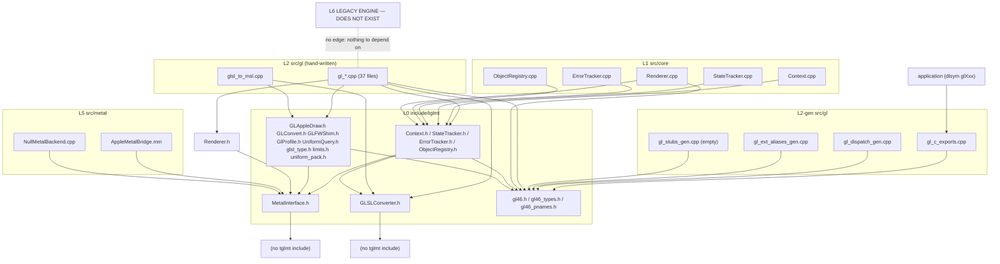

# SUBSYSTEM DEPENDENCY GRAPH — TGLMT (Phase 0)

> Every edge below was **measured**, not inferred: the tables in §4 come from a
> regex scan of every `#include "tglmt/…"` line in `src/**` and `include/**`
> (106 edges from `src/`, 25 edges between headers). No edge is guessed.
> Scan performed 2026-11-11 on the working tree.

---

## 1. Layer model used in this document

| Layer | Name | Files in it |
|---|---|---|
| `L0` | Public headers (`include/tglmt/`) | 18 |
| `L1` | Core context + state (`src/core/`) | 5 |
| `L2` | OpenGL entry-point layer (`src/gl/gl_*.cpp`, hand-written) | 37 |
| `L2-gen` | Generated entry-point artefacts (`src/gl/*_gen.cpp`, `gl_c_exports.cpp`) | 4 |
| `L3` | Shader translation (`src/gl/glsl_to_msl.cpp`) | 1 |
| `L4` | Metal abstraction (`include/tglmt/MetalInterface.h`) | 1 |
| `L5` | Metal backends (`src/metal/`) | 2 |
| `L6` | **Legacy fixed-function / compatibility engine** | **0 — does not exist** |

Subsystem names used in the edge labels:

| Tag | Meaning |
|---|---|
| `H-API(gen)` | `gl46.h`, `gl46_types.h`, `gl46_pnames.h` (machine-generated API surface) |
| `H-CTX` | `Context.h`, `StateTracker.h`, `ErrorTracker.h`, `ObjectRegistry.h` |
| `H-MI` | `MetalInterface.h` |
| `H-SHADER` | `GLSLConverter.h` |
| `H-GLHDR` | the remaining GL-layer helper headers (`GLAppleDraw.h`, `GLConvert.h`, `GLFWShim.h`, `GlProfile.h`, `UniformQuery.h`, `glsl_type.h`, `limits.h`, `uniform_pack.h`) |

---

## 2. ASCII graph (measured edges only)

```
                       ┌──────────────────────────────────────────┐
   application ──────► │ L2-gen  src/gl/gl_c_exports.cpp          │  extern "C" 701 slots
   (dlsym "glXxx")     │         src/gl/gl_dispatch_gen.cpp       │  name manifest (no runtime use)
                       │         src/gl/gl_ext_aliases_gen.cpp    │
                       │         src/gl/gl_stubs_gen.cpp (empty)  │
                       └───────────────────┬──────────────────────┘
                                           │ includes H-API(gen)
                                           ▼
   ┌──────────────────────────────────────────────────────────────────────────┐
   │ L2  src/gl/gl_*.cpp  (36 hand-written files, 24 435 LOC)                 │
   │     validation · object/state mutation · Metal-state baking              │
   │     gl_buffer gl_texture gl_program gl_uniform gl_vertex gl_draw          │
   │     gl_framebuffer gl_raster gl_get gl_get_extra gl_readpixels_dsa       │
   │     gl_sync_query gl_tess_xfb gl_compute gl_sampler gl_shader            │
   │     gl_ext_*.cpp (9) gl_packed_robust gl_debug_p4 glfw_shim             │
   └───────┬──────────────────────────────────────────────┬───────────────────┘
           │ includes H-CTX (36 files)                   │ includes H-SHADER (1)
           │                                              │ includes H-GLHDR (15)
           ▼                                              ▼
   ┌───────────────────────────────┐         ┌──────────────────────────────┐
   │ L1  src/core/                 │         │ L3 src/gl/glsl_to_msl.cpp    │
   │     Context.cpp  StateTracker │         │    GLSL→MSL token rewriter    │
   │     ErrorTracker  ObjectReg   │         │    (12 627 LOC)                │
   │     Renderer.cpp              │         └───────────┬──────────────────┘
   └───────┬───────────────────────┘                     │ includes H-SHADER,
           │  ▲                                           │ H-GLHDR(uniform_pack)
           │  │                                           ▼
           │  │                                    ┌──────────────┐
           │  │                                    │ H-SHADER     │
           │  │                                    │ GLSLConverter│
           │  │                                    └──────────────┘
           │  │
           │  └── H-SHADER (GLSLConverter.h)  ← Context.h:11  (L1 → L3 edge, see §6)
           │
           ├──────────────► H-API(gen) : Context.h → gl46_types.h
           │
           ▼
   ┌────────────────────────────────────────────────────────────┐
   │ L0/H-CTX  include/tglmt/Context.h  (1 302 LOC)             │
   │     ErrorTracker.h  ObjectRegistry.h  StateTracker.h        │
   │     → gl46_types.h                                        │
   │     → MetalInterface.h   (L4)                              │
   │     → GLSLConverter.h    (L3)   ← layering smell           │
   └───────────────┬────────────────────────────────────────────┘
                   │ Context.h:10
                   ▼
   ┌────────────────────────────────────────────────────────────┐
   │ L4  include/tglmt/MetalInterface.h  (926 LOC, 83 virtuals) │
   └───────────────┬────────────────────────────────────────────┘
                   │ implemented by
                   ▼
   ┌────────────────────────────────────────────────────────────┐
   │ L5  src/metal/AppleMetalBridge.mm (3 494 LOC, ObjC++/ARC) │
   │     src/metal/NullMetalBackend.cpp  (79 LOC, CPU shadow)   │
   └────────────────────────────────────────────────────────────┘

   ┌────────────────────────────────────────────────────────────┐
   │ L6  LEGACY FIXED-FUNCTION ENGINE                          │
   │     ▸ NO FILES · NO DIRECTORY · NO SYMBOL                 │
   │     (immediate mode, matrix stack, lighting, fog, texenv, │
   │      texgen, display lists, evaluators, selection,         │
   │      feedback, accumulation, pixel ops, client arrays)    │
   │     → NOTHING TO DRAW AN EDGE TO                          │
   └────────────────────────────────────────────────────────────┘
```

---

## 3. Mermaid graph



---

## 4. Direct include table — every source file

Machine-generated by scanning every `#include "tglmt/…"` line. The number in
parentheses is the **line number** of the include.

| Source file | Layer | Direct `tglmt/…` includes (file:line) |
|---|---|---|
| `include/tglmt/Context.h` | L0 | `gl46_types.h` (:6), `ErrorTracker.h` (:7), `ObjectRegistry.h` (:8), `StateTracker.h` (:9), `MetalInterface.h` (:10), `GLSLConverter.h` (:11) |
| `include/tglmt/ErrorTracker.h` | L0 | `gl46_types.h` (:4) |
| `include/tglmt/GLAppleDraw.h` | L0 | `gl46_types.h` (:4) |
| `include/tglmt/GLConvert.h` | L0 | `MetalInterface.h` (:5) |
| `include/tglmt/GLFWShim.h` | L0 | — (none) |
| `include/tglmt/GLSLConverter.h` | L0 | — (none) |
| `include/tglmt/GlProfile.h` | L0 | — (none) |
| `include/tglmt/MetalInterface.h` | L0 | — (none) |
| `include/tglmt/ObjectRegistry.h` | L0 | `gl46_types.h` (:5) |
| `include/tglmt/Renderer.h` | L0 | `MetalInterface.h` (:11) |
| `include/tglmt/StateTracker.h` | L0 | `gl46_types.h` (:7) |
| `include/tglmt/UniformQuery.h` | L0 | `Context.h` (:9), `glsl_type.h` (:10) |
| `include/tglmt/gl46.h` | L0 | `gl46_types.h` (:6) |
| `include/tglmt/gl46_pnames.h` | L0 | — (none) |
| `include/tglmt/gl46_types.h` | L0 | — (none) |
| `include/tglmt/glsl_type.h` | L0 | — (none) |
| `include/tglmt/limits.h` | L0 | — (none) |
| `include/tglmt/uniform_pack.h` | L0 | — (none) |
| `src/core/Context.cpp` | L1 | `Context.h` (:1) |
| `src/core/ErrorTracker.cpp` | L1 | `ErrorTracker.h` (:1) |
| `src/core/ObjectRegistry.cpp` | L1 | `ObjectRegistry.h` (:1) |
| `src/core/Renderer.cpp` | L1 | `Renderer.h` (:2), `Context.h` (:4), `gl46.h` (:5) |
| `src/core/StateTracker.cpp` | L1 | `StateTracker.h` (:1) |
| `src/gl/gl_apple_draw.cpp` | L2 | `gl46.h` (:8), `Context.h` (:9), `GLConvert.h` (:10), `uniform_pack.h` (:11) |
| `src/gl/gl_buffer.cpp` | L2 | `gl46.h` (:4), `Context.h` (:5) |
| `src/gl/gl_c_exports.cpp` | L2-gen | `gl46.h` (:5), `GlProfile.h` (:6) |
| `src/gl/gl_compute.cpp` | L2 | `gl46.h` (:3), `Context.h` (:4) |
| `src/gl/gl_debug_p4.cpp` | L2 | `gl46.h` (:4), `Context.h` (:5) |
| `src/gl/gl_dispatch_gen.cpp` | L2-gen | `gl46.h` (:2) |
| `src/gl/gl_draw.cpp` | L2 | `gl46.h` (:3), `Context.h` (:4), `GLAppleDraw.h` (:5) |
| `src/gl/gl_draw_buffers2_p8.cpp` | L2 | `gl46.h` (:4), `Context.h` (:5) |
| `src/gl/gl_error_string_debug.cpp` | L2 | `gl46.h` (:3), `Context.h` (:4) |
| `src/gl/gl_ext_aliases_gen.cpp` | L2-gen | `gl46.h` (:5) |
| `src/gl/gl_ext_attrib64.cpp` | L2 | `gl46.h` (:2), `Context.h` (:3) |
| `src/gl/gl_ext_bindless.cpp` | L2 | `gl46.h` (:2), `Context.h` (:3) |
| `src/gl/gl_ext_dsa_state.cpp` | L2 | `gl46.h` (:2), `Context.h` (:3) |
| `src/gl/gl_ext_dsa_texture.cpp` | L2 | `gl46.h` (:2), `Context.h` (:3) |
| `src/gl/gl_ext_imaging.cpp` | L2 | `gl46.h` (:2), `Context.h` (:3) |
| `src/gl/gl_ext_include_shading.cpp` | L2 | `gl46.h` (:2), `Context.h` (:3) |
| `src/gl/gl_ext_misc.cpp` | L2 | `gl46.h` (:2), `Context.h` (:3) |
| `src/gl/gl_ext_path_command.cpp` | L2 | `gl46.h` (:4), `Context.h` (:5) |
| `src/gl/gl_ext_perf.cpp` | L2 | `gl46.h` (:2), `Context.h` (:3) |
| `src/gl/gl_ext_state.cpp` | L2 | `gl46.h` (:2), `Context.h` (:3) |
| `src/gl/gl_ext_uniform64.cpp` | L2 | `gl46.h` (:3), `Context.h` (:4) |
| `src/gl/gl_framebuffer.cpp` | L2 | `gl46.h` (:3), `Context.h` (:4), `GLAppleDraw.h` (:5) |
| `src/gl/gl_get.cpp` | L2 | `gl46.h` (:3), `Context.h` (:4), `glsl_type.h` (:5), `UniformQuery.h` (:6), `limits.h` (:7), `gl46_pnames.h` (:8) |
| `src/gl/gl_get_extra.cpp` | L2 | `gl46.h` (:6), `Context.h` (:7) |
| `src/gl/gl_multisample_p8.cpp` | L2 | `gl46.h` (:5), `Context.h` (:6) |
| `src/gl/gl_packed_robust.cpp` | L2 | `gl46.h` (:5), `Context.h` (:6), `UniformQuery.h` (:7) |
| `src/gl/gl_program.cpp` | L2 | `gl46.h` (:3), `Context.h` (:4), `glsl_type.h` (:5) |
| `src/gl/gl_program_interface_p10.cpp` | L2 | `gl46.h` (:5), `Context.h` (:6) |
| `src/gl/gl_raster.cpp` | L2 | `gl46.h` (:4), `Context.h` (:5) |
| `src/gl/gl_readpixels_dsa.cpp` | L2 | `gl46.h` (:5), `Context.h` (:6) |
| `src/gl/gl_sampler.cpp` | L2 | `gl46.h` (:3), `Context.h` (:4) |
| `src/gl/gl_shader.cpp` | L2 | `gl46.h` (:4), `Context.h` (:5), `GLSLConverter.h` (:6) |
| `src/gl/gl_shader_objects_p8.cpp` | L2 | `gl46.h` (:4), `Context.h` (:5) |
| `src/gl/gl_stubs_gen.cpp` | L2-gen | `gl46.h` (:3), `Context.h` (:4) |
| `src/gl/gl_sync_query.cpp` | L2 | `gl46.h` (:3), `Context.h` (:4) |
| `src/gl/gl_tess_xfb.cpp` | L2 | `gl46.h` (:11), `Context.h` (:12) |
| `src/gl/gl_texture.cpp` | L2 | `gl46.h` (:3), `Context.h` (:4) |
| `src/gl/gl_uniform.cpp` | L2 | `gl46.h` (:3), `Context.h` (:4), `uniform_pack.h` (:5), `glsl_type.h` (:6), `limits.h` (:7) |
| `src/gl/gl_vertex.cpp` | L2 | `gl46.h` (:3), `Context.h` (:4) |
| `src/gl/glfw_shim.cpp` | L2 | `GLFWShim.h` (:2), `Renderer.h` (:3), `Context.h` (:4), `GlProfile.h` (:5), `gl46.h` (:6) |
| `src/gl/glsl_to_msl.cpp` | L3 | `GLSLConverter.h` (:3), `uniform_pack.h` (:4) |
| `src/metal/AppleMetalBridge.mm` | L5 | `MetalInterface.h` (:13) |
| `src/metal/NullMetalBackend.cpp` | L5 | `MetalInterface.h` (:3) |

---

## 5. Header-level include table

| Header | Direct `tglmt/…` includes |
|---|---|
| `include/tglmt/Context.h` | `gl46_types.h` (:6), `ErrorTracker.h` (:7), `ObjectRegistry.h` (:8), `StateTracker.h` (:9), `MetalInterface.h` (:10), `GLSLConverter.h` (:11) |
| `include/tglmt/ErrorTracker.h` | `gl46_types.h` (:4) |
| `include/tglmt/GLAppleDraw.h` | `gl46_types.h` (:4) |
| `include/tglmt/GLConvert.h` | `MetalInterface.h` (:5) |
| `include/tglmt/GLFWShim.h` | — (none) |
| `include/tglmt/GLSLConverter.h` | — (none) |
| `include/tglmt/GlProfile.h` | — (none) |
| `include/tglmt/MetalInterface.h` | — (none) |
| `include/tglmt/ObjectRegistry.h` | `gl46_types.h` (:5) |
| `include/tglmt/Renderer.h` | `MetalInterface.h` (:11) |
| `include/tglmt/StateTracker.h` | `gl46_types.h` (:7) |
| `include/tglmt/UniformQuery.h` | `Context.h` (:9), `glsl_type.h` (:10) |
| `include/tglmt/gl46.h` | `gl46_types.h` (:6) |
| `include/tglmt/gl46_pnames.h` | — (none) |
| `include/tglmt/gl46_types.h` | — (none) |
| `include/tglmt/glsl_type.h` | — (none) |
| `include/tglmt/limits.h` | — (none) |
| `include/tglmt/uniform_pack.h` | — (none) |

### 5.1 Aggregate edge counts (source layer → header subsystem)

| Source layer | → `H-API(gen)` | → `H-CTX` | → `H-MI` | → `H-SHADER` | → `H-GLHDR` | Total |
|---|---:|---:|---:|---:|---:|---:|
| `L2` (36 hand-written `src/gl` files) | 37 | 36 | 0 | 1 | 15 | 89 |
| `L2-gen` (4 generated `src/gl` files) | 4 | 1 | 0 | 0 | 1 | 6 |
| `L1` (`src/core`, 5 files) | 1 | 5 | 0 | 0 | 1 | 7 |
| `L3` (`glsl_to_msl.cpp`) | 0 | 0 | 0 | 1 | 1 | 2 |
| `L5` (`src/metal`, 2 files) | 0 | 0 | 2 | 0 | 0 | 2 |
| **Total** | **42** | **42** | **2** | **2** | **18** | **106** |

Notes:
* `L5 → H-MI` is the **only** place the Metal backend is reached, and it is
  clean: both backend files include exactly one header
  (`src/metal/AppleMetalBridge.mm:13`, `src/metal/NullMetalBackend.cpp:3`).
  The Metal abstraction does **not** leak into the API layer through a header —
  it reaches it only transitively via `Context.h:10`.
* `L2 → H-MI` is **0 as a *direct* include**: no file in `src/gl/` includes
  `MetalInterface.h` directly. All Metal access from the API layer goes
  through `Context`'s `std::shared_ptr<metal::IDevice>`
  (`include/tglmt/Context.h:641`).
  **One transitive path exists**: `src/gl/glfw_shim.cpp:3` includes
  `tglmt/Renderer.h`, and `include/tglmt/Renderer.h:11` includes
  `tglmt/MetalInterface.h`. So the *window shim* is the only API-layer file
  that can see the Metal abstraction types; the other 35 cannot.
* `L1 → H-API(gen)` = 1 is the single inversion analysed in §6.1.

---

## 6. Cycles and layering violations

### 6.1 Header-level cycles: **NONE**

A DFS over the 18 `include/tglmt/*.h` headers (edges in §5) finds **zero
cycles**. The header graph is a DAG. `include/tglmt/gl46_types.h`,
`gl46_pnames.h`, `MetalInterface.h`, `GLSLConverter.h`, `GlProfile.h`,
`glsl_type.h`, `limits.h`, `uniform_pack.h`, `GLFWShim.h` are all leaves.

### 6.2 Module-level cycle: **ONE** (`src/core` ↔ `src/gl`)

| Step | Evidence |
|---|---|
| core calls the API layer | `src/core/Renderer.cpp:5` `#include "tglmt/gl46.h"`; `src/core/Renderer.cpp:98` `gl::glReadPixels(...)`; `src/core/Renderer.cpp:99` `gl::glGetError() == 0` |
| those symbols are defined in the API layer | `src/gl/gl_readpixels_dsa.cpp:89` `void glReadPixels(...)` (namespace `tglmt::gl` opened at `:15`); `src/gl/gl_error_string_debug.cpp:10` `GLenum glGetError()` (namespace opened at `:9`) |
| the API layer calls back into core | `src/gl/gl_readpixels_dsa.cpp:4` `#include "tglmt/Context.h"`; `src/gl/gl_error_string_debug.cpp:4` `#include "tglmt/Context.h"` |
| `Context.h` is implemented in core | `src/core/Context.cpp:1` `#include "tglmt/Context.h"` |

**Severity: LOW today, HIGH if a legacy engine is added.**
The link is resolved because everything ends up in one archive
(`CMakeLists.txt:68` `add_library(tglmt_objs OBJECT …)` → `:80` `add_library(tglmt STATIC …)`).
But a legacy fixed-function engine needs *core* to query legacy state (matrix
stack, current texcoords, lighting) while core's `Renderer` would want to
present through the legacy path. If the legacy engine is placed under
`src/gl/legacy/` and the core grows a `legacy*` member, the cycle becomes a
link-order problem instead of a documentation problem.
**Mitigation:** move `Renderer::ReadPixels` out of `src/core` into the API layer
(`src/gl/`), or expose the readback through `Context`/`IDevice` only. That
removes the only `core → api` edge and makes the module graph a DAG.

### 6.3 Layering smell: core (`L1`) depends on shader translation (`L3`)

| Evidence | Detail |
|---|---|
| `include/tglmt/Context.h:11` | `#include "tglmt/GLSLConverter.h"` |
| `include/tglmt/Context.h:213` | `GLSLConvertResult conv;   // kết quả converter (varyings/uniforms/layout)` — a member of `ShaderObject` |
| `include/tglmt/Context.h:385` | `std::vector<GLSLConvertResult::BlockSlot> computeBlockSlots;` — a member of `ProgramObject` |
| `include/tglmt/GLSLConverter.h:3-25` | The header documents a *narrow* GLSL subset with "ngoài subset sẽ báo lỗi rõ ràng" |

So the core context header is **load-bearing coupled** to the shader
translator: every translation unit that includes `Context.h` (36 of the 41
`src/gl` files plus all 5 `src/core` files) transitively parses the translator
contract.

**Impact on the 1.0–4.6 mission:** a legacy fixed-function engine that needs
"current GLSL type" knowledge would push this coupling further (fixed-function
attribute types ↔ GLSL type system). **Recommended:** move
`GLSLConvertResult conv` out of `ShaderObject` (keep only the *outputs* the
core needs: a flat list of `{name, type, location}`) and store the full
converter result in the shader/program object in `src/gl/` instead.

### 6.4 Layering smell: `include/tglmt/` mixes four layers in one directory

`include/tglmt/` holds, side by side:

* core state (`Context.h`, `StateTracker.h`, `ErrorTracker.h`, `ObjectRegistry.h`),
* the Metal backend abstraction (`MetalInterface.h`),
* the shader translator contract (`GLSLConverter.h`),
* GL-layer helpers (`GLAppleDraw.h`, `GLConvert.h`, `UniformQuery.h`, `glsl_type.h`, `limits.h`, `uniform_pack.h`, `GlProfile.h`),
* app façades (`Renderer.h`, `GLFWShim.h`),
* the generated API surface (`gl46.h`, `gl46_types.h`, `gl46_pnames.h`).

Consequences that matter for the legacy work:
1. `include/tglmt/UniformQuery.h:9` — a *GL-layer* helper includes the *core*
   `Context.h`. The direction (GL → core) is correct, but the placement makes
   "include the public header" == "include the whole core + the Metal
   abstraction + the shader translator".
2. There is **no `install()` rule** (`grep -n "install" CMakeLists.txt apps/aquarium/CMakeLists.txt`
   → no match), so "public" currently means "on the include path of the build
   tree" only. When a legacy engine and a versioned API surface (1.0–4.6) are
   added, the public header set will need to be split by layer
   (`tglmt/core/`, `tglmt/gl/`, `tglmt/metal/`) **before** an SDK is published.
3. `include/tglmt/gl46.h` currently mixes core and compat-only declarations in
   one namespace (`include/tglmt/gl46.h:1-4` banner, `:666-711` compat block).
   For a versioned 1.0–4.6 surface this file must become per-version or
   per-profile, otherwise the "one context reports 4.6 core" model
   (`src/gl/gl_get.cpp:140-148`) cannot express "context is 1.5 compatibility".

### 6.5 Non-violation: the Metal abstraction does not leak upward

`L2 → H-MI` = 0 and `L1 → H-MI` = 0 as *direct* includes. `MetalInterface.h`
reaches the core only through `Context.h:10`, and the core reaches Metal only
through `Context::device` (`include/tglmt/Context.h:641`,
`std::shared_ptr<metal::IDevice>`) and the `metal::` value types
(`Context.h:972`, `:995`, `:1024`, `:1037` — `metal::Viewport`,
`metal::ScissorRect`, `metal::PixelFormat`, `metal::CustomAttrib`).
This is the healthiest edge in the tree and should be preserved.

---

## 7. What a legacy (1.0–2.1) engine would have to attach to

Derived from the measured graph — these are the *attachment points* an
`L6` engine would need, and the edges it would create:

| Needed by the legacy engine | Existing attachment point | New edge it would create |
|---|---|---|
| GL state (caps, blend, depth, viewport, texture bindings) | `include/tglmt/StateTracker.h` (`L0/H-CTX`) | `L6 → H-CTX` |
| Object stores (buffers, textures, VAOs, FBOs, programs) | `include/tglmt/Context.h:644-661` (12 maps) | `L6 → H-CTX` |
| Error reporting | `include/tglmt/ErrorTracker.h:14` `Record(GLenum)` | `L6 → H-CTX` |
| Entry points (`glBegin`, `glVertex3f`, `glMatrixMode`, `glTexEnvf`, …) | `include/tglmt/gl46.h` — **currently only 657 core + 42 compat-only, none of them legacy 1.x** | `L6 → H-API(gen)` + the generated C-export layer |
| Metal draw submission | `include/tglmt/GLAppleDraw.h:7` `AppleDrawGL(...)` and `src/gl/gl_apple_draw.cpp` | `L6 → L2` |
| Coordinate/matrix math | **nothing exists** — no matrix type in the tree | new module |
| GLSL 1.10/1.20 (for the 2.0/2.1 programmable path) | `src/gl/glsl_to_msl.cpp` (subset converter) | `L3 → L6` or a new `L3-legacy` |

**Measured fact:** 349 GL 1.0–2.1 commands are present in
`docs/khronos/gl.xml` but are neither declared in `include/tglmt/gl46.h` nor
exported from `libtglmt.dylib` (computed from `tools/gl46_catalog.py` +
`docs/khronos/gl.xml`; the only partial exception is `glLineStipple`, which
exists as a **no-op** at `src/gl/gl_raster.cpp:274` and is exported through the
bonus path at `src/gl/gl_c_exports.cpp:2810`, but is **not** declared in
`gl46.h`).
